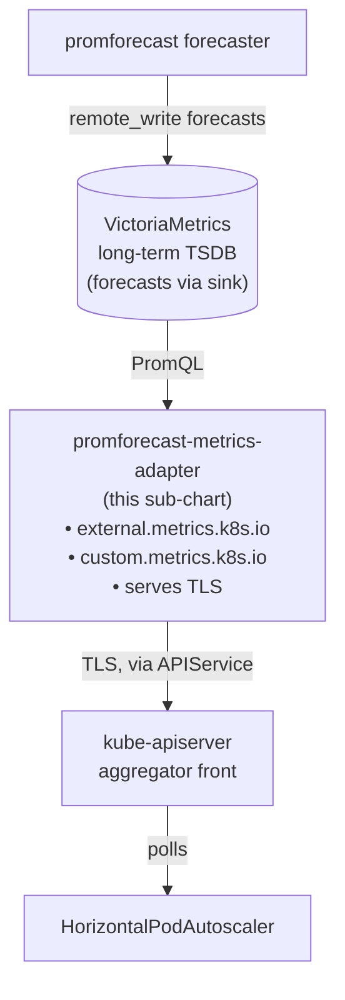

# Predictive autoscaling with Kubernetes HPA

The `promforecast-metrics-adapter` sub-component exposes promforecast forecasts through the Kubernetes custom-metrics API.  
HorizontalPodAutoscaler can then scale **on the forecast** of load 15–30 minutes ahead instead of reacting to current load — capacity arrives *before* the spike.

The adapter is a separate deployable (own Helm chart and container entrypoint). The main forecaster is unaffected.

## Architecture



Stateless: the adapter only reads forecasts that the main forecaster has already written to VictoriaMetrics via the sink.

## Install

```bash
helm install promforecast-adapter ./charts/promforecast-metrics-adapter \
  --namespace monitoring \
  --set datasourceUrl=http://victoriametrics:8428 \
  --values - <<'EOF'
metrics:
  - externalMetricName: rps-forecast
    promql: 'sum by (service)(http_requests_rate_forecast{service="$service"})'
    namespaced: true
  - externalMetricName: cpu-forecast
    promql: 'avg(node_cpu_busy_pct_forecast)'
    namespaced: false
EOF
```

The chart creates a self-signed cert, registers the two required `APIService` objects, and sets up RBAC. No cert-manager needed.

## Config reference

```yaml
# values.yaml
datasourceUrl: http://victoriametrics:8428

metrics:
  - externalMetricName: rps-forecast
    promql: |
      sum by (service)(
        http_requests_rate_forecast{service="$service"}
      )
    namespaced: true

tls:
  generate: true          # self-signed cert
  validityDays: 3650
  # existingSecret: my-adapter-tls   # optional
```

**Placeholders** in `promql` are substituted from the HPA’s label selector. Namespaced metrics automatically get `namespace=$namespace`.

## HPA example

```yaml
apiVersion: autoscaling/v2
kind: HorizontalPodAutoscaler
metadata:
  name: payments-api-predictive
spec:
  scaleTargetRef:
    apiVersion: apps/v1
    kind: Deployment
    name: payments-api
  minReplicas: 3
  maxReplicas: 30
  metrics:
    - type: External
      external:
        metric:
          name: rps-forecast
          selector:
            matchLabels:
              service: payments-api
        target:
          type: AverageValue
          averageValue: "50"
  behavior:
    scaleUp:
      stabilizationWindowSeconds: 0
    scaleDown:
      stabilizationWindowSeconds: 600
```

A full example ships in `examples/k8s/predictive-hpa.yaml`.

## Quality gate

Forecast quality is a hard prerequisite for safe predictive scaling.  
Common pattern: run **two HPAs** on the same target:

- **Primary** — predictive HPA (the one above).
- **Fallback** — classic reactive HPA on CPU / request rate with a higher target.

Kubernetes `selectPolicy: Max` ensures the more aggressive recommendation wins. The predictive HPA usually leads; the reactive one is the safety net.

For tighter control you can gate the predictive HPA on `forecast_quality_score > 0.6` (small operator or custom metric).

## Failure modes

| State                          | Adapter response          | HPA sees                  |
|--------------------------------|---------------------------|---------------------------|
| VM unreachable                 | 503 ServiceUnavailable    | Metric unavailable        |
| Metric not found               | 404 NotFound              | `failedGetMetric`         |
| PromQL returns no series       | 200 with value `0`        | Treated as zero           |
| Forecast is NaN / Inf          | 200 with value `0`        | Treated as zero           |

Use `clamp_min(..., 0.001)` in the PromQL if you need to distinguish “no data” from “real zero”.

## Verification

```bash
# Check pod and APIServices
kubectl -n monitoring get pods -l app.kubernetes.io/name=promforecast-metrics-adapter
kubectl get apiservice v1beta1.external.metrics.k8s.io

# Test the metric directly
kubectl get --raw "/apis/external.metrics.k8s.io/v1beta1/namespaces/payments/rps-forecast" | jq .
```

## Operational notes

- **TLS cert rotation** — the chart reuses the existing Secret on `helm upgrade`. To force rotation, delete the `<release>-tls` Secret.
- **No hot-reload** — metric mappings are part of the Kubernetes API surface, so changes require a Deployment rollout.
- **Compatibility** — if you already run prometheus-adapter, set `apiService.enabled: false` on this chart.
- **Single replica is sufficient** — the adapter is stateless and HPA retries on 503.
- **Security** — the adapter trusts the kube-apiserver aggregator. Use a NetworkPolicy pinned to the apiserver pods in multi-tenant clusters.

See also:
- [`preview.md`](preview.md) — single-query what-if
- [`capacity.md`](capacity.md) — the underlying forecast metrics
- [`maintenance-windows.md`](maintenance-windows.md) — ranked quiet windows
